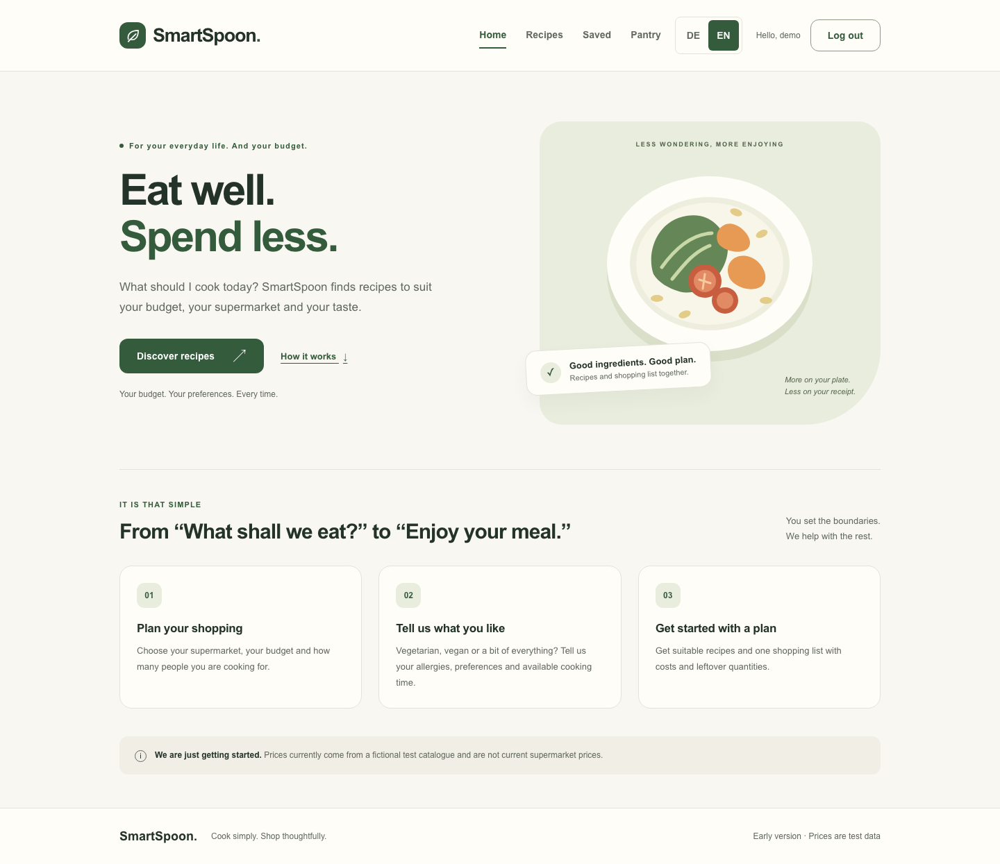
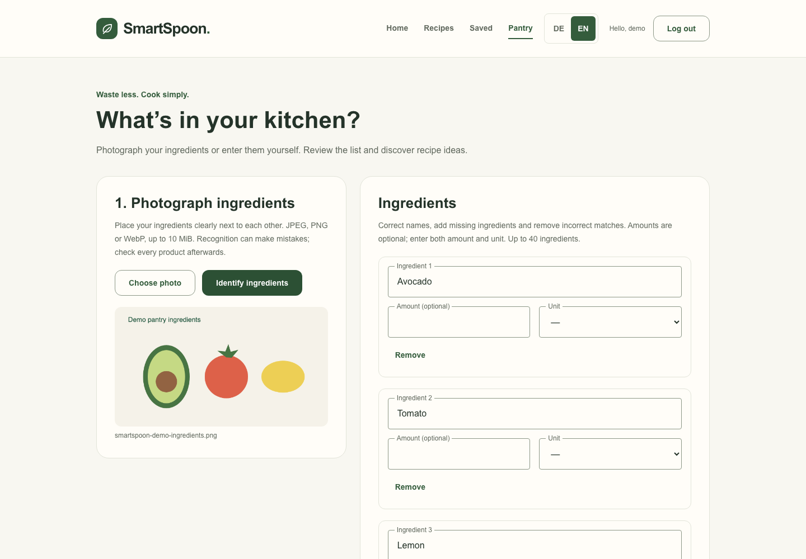
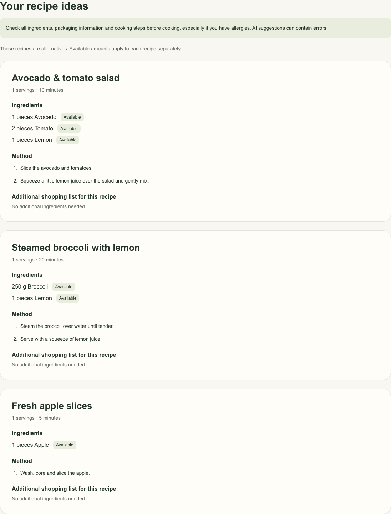
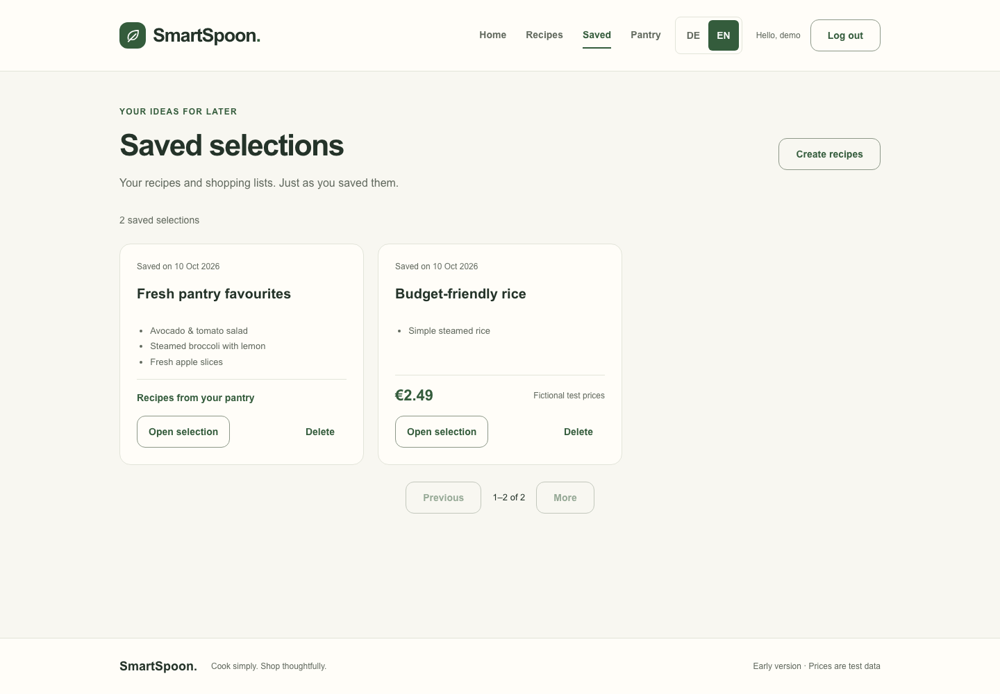

# SmartSpoon

AI-assisted recipe ideas and shopping lists, built with Angular and NestJS.
Plan recipes around a budget or use ingredients you already have. The interface
supports English and German.

> SmartSpoon is under active development. Supermarket prices currently come from
> a fictional test catalog, not live supermarket data. Recipe suggestions are
> alternatives, not a complete weekly meal plan.

## Features

- Register and sign in with a username, password and date of birth.
- Request recipes using a supermarket, budget, servings, dietary preferences,
  allergies, ingredient exclusions and cooking time.
- Calculate shopping costs from catalog prices and whole package sizes.
- Enter pantry ingredients manually or identify them from a photo using a local
  vision model, then review and confirm them before generating recipes.
- Choose whether pantry recipes may require additional ingredients.
- Save complete recipe selections and shopping lists to your account.

## Screenshots

The English interface below uses fictional demo data and mocked API responses.
The ingredient-upload preview is an original illustration, not a photo-recognition
accuracy example. No personal accounts, photos or API keys are shown.

### Home



<details>
<summary>Ingredient review after a demo photo upload</summary>



</details>

<details>
<summary>Recipe alternatives from pantry ingredients</summary>



</details>

<details>
<summary>Saved recipes and shopping lists</summary>



</details>

## Technology

| Area | Stack |
| --- | --- |
| Frontend | Angular, TypeScript, Tailwind CSS, classic NgRx, JSON translations |
| Backend | NestJS, TypeScript, REST API, Swagger |
| Database | MongoDB with Mongoose |
| Recipe generation | Gemini API with the official Google SDK |
| Optional photo recognition | Python, Pillow, Ollama, Qwen3-VL |
| Development and checks | Docker Compose, GitHub Actions |

The backend is a modular monolith. Angular features live under
`Frontend/src/app/features`, reusable UI under `shared/ui`, and NgRx stores under
`shared/store`. Each component has separate TypeScript, HTML and SCSS files.

## Quick start with Docker

You need Git and Docker with Docker Compose. Node.js 24.15 or later is needed for
local development and the secret-generation command below.

```sh
git clone https://github.com/mofar1976/SmartSpoon.git
cd SmartSpoon/Backend
cp .env.example .env
node -e "console.log(require('node:crypto').randomBytes(32).toString('hex'))"
```

Set `JWT_SECRET` in `Backend/.env` to the generated value. Set `GEMINI_API_KEY` to
your own key from [Google AI Studio](https://aistudio.google.com/) to enable recipe
generation. API availability, quotas and billing depend on your Google project.
The model is configurable using `GEMINI_MODEL`.

If port 27017 is already in use, change `MONGODB_PORT` in `.env`. For a locally
running NestJS process, also adjust the port in `MONGODB_URI`.

```sh
docker compose up --build --wait
docker compose exec backend node dist/scripts/seed-products.js
```

The seed command adds the fictional supermarket catalog. Pantry recipes do not
require this catalog. Without a Gemini key, account and saved-selection endpoints
remain available, but recipe generation is unavailable.

- Application: http://localhost:8080
- API documentation: http://localhost:8080/api/docs
- Backend readiness: http://localhost:3000/api/health/ready

`FRONTEND_PORT` changes the frontend port. `docker compose down` stops the stack
while retaining database contents; adding `--volumes` deletes them. Database and
volume names retain the project's former name to preserve existing local data.
This Compose setup is for local development and binds published ports to loopback;
it is not a production deployment configuration.

## Optional photo recognition

Manual ingredient entry works without the vision service. For photos, install
Ollama and run it locally. The current setup is documented for native Ollama on
macOS with Docker Desktop.

In a separate terminal:

```sh
OLLAMA_NO_CLOUD=1 OLLAMA_HOST=127.0.0.1:11434 ollama serve
```

Then download the model:

```sh
ollama pull qwen3-vl:4b-instruct
```

Generate another random value using the command above and set it as
`INGREDIENT_RECOGNITION_TOKEN` in `Backend/.env`. From `Backend/`:

```sh
docker compose --profile vision up --build --wait
```

The service reaches host Ollama through `host.docker.internal`; other host setups
may need networking changes. Model weights are downloaded separately and are not
included in this repository. Recognition speed depends on local hardware.
See the [vision service guide](Backend/ingredient-recognition/README.md).

## Local development

Start the Docker stack first. To develop the Angular frontend with hot reload:

```sh
cd Frontend
npm ci
npm start
```

Open http://localhost:4200. The development proxy forwards `/api` requests to the
backend on port 3000.

For NestJS development outside Docker, follow the
[backend setup](Backend/README.md#lokale-entwicklung-mit-nodejs) instead of running
the Docker backend on the same port. More details:
[backend guide](Backend/README.md) and [frontend guide](Frontend/README.md).

## Checks

From `Backend/`:

```sh
npm ci
npm run typecheck
npm test
```

From `Frontend/`:

```sh
npm ci
npm run typecheck
npm test
npm run build
```

GitHub Actions also runs isolated MongoDB integration tests and Docker checks.
Unit tests use mocks rather than real Gemini requests. Integration test setup is
documented in the backend guide.

## Data and current limitations

- Uploaded photos are processed in memory by the local recognition service; they
  are not stored or sent to Gemini. Confirmed ingredient text, recipe preferences
  and age derived from the account's date of birth are sent to Gemini.
- Recipe preferences are submitted per request and are not stored in the user
  profile. Saving is explicit and stores the recipe and shopping-list snapshot.
- AI recognition and recipes can be incorrect. Confirm ingredients and check
  product labels and allergens before cooking; pantry recipes do not provide a
  guarantee of allergy safety.
- Pantry shopping lists have no price estimates. Supermarket recipe costs use
  explicitly fictional catalog prices.
- Full weekly planning and live supermarket price sources are not implemented.

## Contributing

See [CONTRIBUTING.md](CONTRIBUTING.md) for development and review conventions.
Report vulnerabilities privately as described in [SECURITY.md](SECURITY.md).


Changes should start on a feature branch and be proposed through a pull request
against `develop`. `preview` and `main` are the subsequent promotion stages.
Include a clear description and relevant validation results. Keep credentials,
local `.env` files, personal photos and database data out of commits.

## License

SmartSpoon is licensed under the [MIT License](LICENSE).
Dependency and model licenses apply separately; see
[third-party notices](THIRD_PARTY_NOTICES.md) and the dependency inventory.
